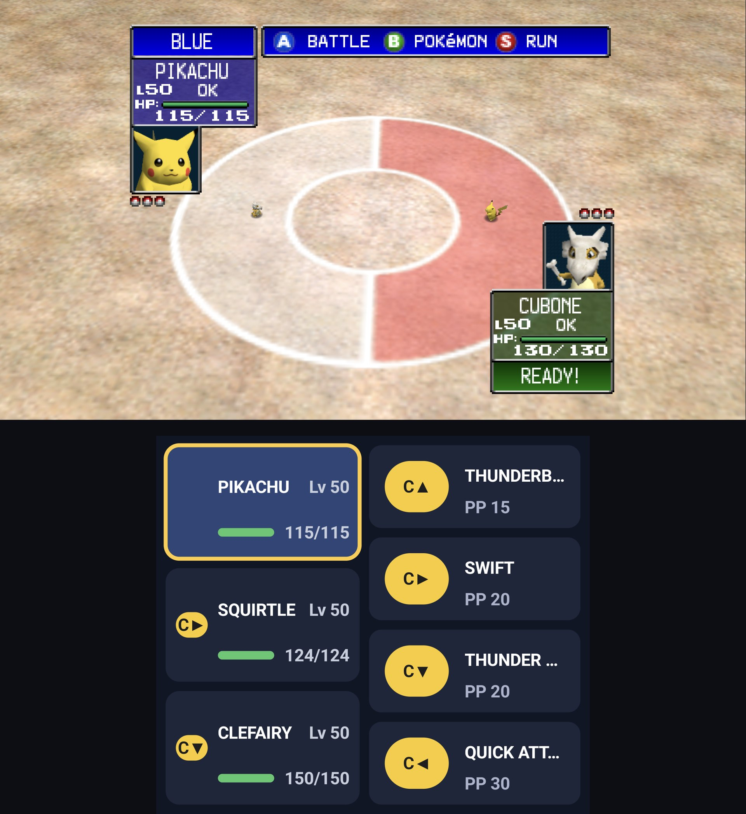

# Stadium Recomp

**Pokémon Stadium (US v1.0), recompiled to run natively on Windows and Android**, with a dual-screen battle panel for the AYN Thor, Transfer Pak saves that really write back, widescreen battles and more.

A community fork of [SS Anne / PokemonStadiumRecomp](https://github.com/mstan/PokemonStadiumRecomp) by mstan, which is no longer maintained. This fork keeps it going.

**[Download the latest release](https://github.com/bearfeet0511/PokemonStadiumRecomp/releases)** · Beta: expect bugs, and please report them in [Issues](https://github.com/bearfeet0511/PokemonStadiumRecomp/issues).

No ROMs or game assets are included. Bring your own Pokémon Stadium (US v1.0) ROM and, for the Transfer Pak, your own Game Boy ROMs and saves.

## Features

- **Native, not emulated.** The game's code is recompiled to native code (N64Recomp) and drawn with RT64 on Direct3D 12 or Vulkan.
- **Windows and Android.** Android needs a 64-bit ARM device with Vulkan; it's developed on the AYN Thor (Snapdragon 8 Gen 2) and works on single-screen devices too.
- **Dual-screen battle panel** (Android, dual-screen devices). The second screen shows your team with HP and status and the active Pokémon's moves with PP and their buttons. Tap a move to use it, tap a team member twice to switch, and tap buttons on the team-pick screen. A dimmed Stadium logo the rest of the time.
- **Transfer Pak with real write-back.** Use your Pokémon Red, Blue or Yellow cart and save: Pokémon Lab storage and trades are saved straight to your own `.sav`, the same file your Game Boy emulator uses. No exporting. Two players, each with their own cart.
- **Gen1Recomp saves** (Windows for now). Use a [Gen1Recomp](https://github.com/bryanthaboi/gen1recomp) save slot as a cart; changes are merged back, keeping mod data such as nuzlocke tracking.
- **Smooth battles.** A renderer fix keeps send-outs, moves and camera pans from dropping frames, even on handhelds.
- **Widescreen battles** (experimental). Menus stay 4:3.
- **60 fps** (experimental). In-between frames while the game runs at its normal speed. On the AYN Thor, use Performance mode for smooth send-outs.
- **Español / Français.** Game text in Spanish or French, read from your own copy of that version of Stadium (the game still runs from your US ROM). With Español chosen, the launchers and the battle panel are in Spanish too.
- **Save safety.** Automatic backups every session; on Android, saves can also be copied to a folder of your choice that survives uninstalling.
- **Updates in the app.** The launcher on both platforms tells you when a new build is out and installs it without touching your saves.
- **Online play** (testing, Windows for now). Netplay builds are in the test releases.

Features land on one platform first and are meant to reach both.

## Getting started

### Windows
1. Download `PokemonStadiumRecomp-…-win64.zip` from [Releases](https://github.com/bearfeet0511/PokemonStadiumRecomp/releases) and unzip it anywhere.
2. Run `PokemonStadiumRecomp.exe`. The launcher asks for your Pokémon Stadium ROM the first time (`.z64`, `.n64` or `.v64`).
3. Optionally give each player a Game Boy cart (ROM + save) and a controller, then press **Play**.

Widescreen battles, 60 fps and the language are in the launcher's **Settings**. They are saved in `launcher.cfg` next to the exe.

### Android
1. Download `StadiumRecomp-android-….apk` from [Releases](https://github.com/bearfeet0511/PokemonStadiumRecomp/releases) and install it (allow installs from your browser or file manager when asked).
2. Open **Stadium Recomp** and choose your Stadium ROM. For the Transfer Pak, choose a Game Boy ROM and its `.sav` per player. The save stays linked: Stadium's changes are written straight back to that file, and changes you make in your Game Boy emulator are picked up next time you press Play.
3. Recommended: **Choose backup folder**, for example Documents.
   For Spanish or French text, tap **Language** and choose your Spanish or French Pokémon Stadium ROM.
4. Press **Play**. In the launcher, use the D-pad to move, A to select, B to close and Start to play.

Keep your `.sav` in a normal folder such as Documents or Download: since Android 11, apps can't open files inside another app's private `Android/data` folder. To update, use the in-app update or install the new APK over the old one. **Don't uninstall to update:** uninstalling deletes the app's folder, including saves you haven't backed up.

### Game Boy saves
Stadium only accepts a Red/Blue/Yellow save that was made inside a Pokémon Center. A brand-new save may also need one PC box change in the Game Boy game before Stadium accepts it.

## Controls

**Game controller** (Xbox-style layout; DualSense / DualShock and Android handhelds map the same way):

| N64 | Controller |
|-----|------------|
| A / B | A / B |
| Start | Start |
| L / R | Left / Right bumper |
| Z | Either trigger |
| D-Pad | D-Pad |
| Control Stick | Left stick |
| C-Buttons | Right stick |

**Keyboard** (Windows): `X`→A, `Z`→B, `Enter`→Start, `Q`→L, `E`→R, `Left-Shift`/`Space`→Z, arrow keys→D-Pad, `W`/`A`/`S`/`D`→Control Stick, `I`/`K`/`J`/`L`→C-Up/Down/Left/Right.

## Known issues

- Widescreen: trainer name boxes start at the screen edge and jump into place as they slide in, and some full-screen move effects (Surf's blue tint, Stun Spore and others) stop short of the screen edges. The team-confirm screen's fade stays 4:3; menus are 4:3 on purpose.
- 60 fps: some Pokémon look see-through or split for a moment when they move quickly (seen on Slowbro, Dragonite, Gastly).
- Español / Français: only the text changes; menu graphics with words on them and the announcer stay English.
- Android: GB Tower takes about 50 seconds to load and its picture is off-centre.
- Inherited from upstream: see [`ISSUES.md`](ISSUES.md).

## Troubleshooting

**Windows says the download is a virus, or SmartScreen blocks it.** This is a false positive. Recompiled N64 code doesn't look like normal compiler output, and the exe isn't code-signed (that needs a paid certificate). Restore the file or add an exclusion for its folder. If you'd rather not trust a prebuilt binary, build it yourself from source.

**No sound.** Audio follows your system's default output device. To pick another one: `PSR_AUDIO_DEVICE=<part of the device name>`.

**It closes straight away.** Usually the Direct3D 12 device couldn't start; the renderer then falls back to Vulkan automatically. If it still won't start, update your GPU drivers or force a backend with `PSR_GRAPHICS_API=vulkan` (or `d3d12`). A `last_error.log` is written next to the exe; please attach it to bug reports.

**Wrong ROM.** Only Pokémon Stadium US v1.0 works: MD5 `ed1378bc12115f71209a77844965ba50`, 32 MB. Rev A (v1.1) doesn't.

## Building from source

The full Windows and Android build steps, tool versions and project notes are in [`STADIUM.md`](STADIUM.md). In short: pret's disassembly is built in Docker to an ELF, N64Recomp turns it into C, and CMake builds that with N64ModernRuntime and RT64. Dependencies are fetched at pinned versions by `tools\setup_libs.ps1`, with this fork's fixes applied from `patches\`. Android is built with the NDK and Gradle by `tools\android_build.ps1`.

## About upstream

SS Anne was created by mstan, who stopped maintaining it in August 2026 and welcomed forks; his reasons are in [the upstream README](https://github.com/mstan/PokemonStadiumRecomp#readme). Please send bug reports for this fork here rather than upstream.

## Credits

- [SS Anne / PokemonStadiumRecomp](https://github.com/mstan/PokemonStadiumRecomp) and its [N64Recomp](https://github.com/mstan/N64Recomp), [N64ModernRuntime](https://github.com/mstan/N64ModernRuntime) and [rt64](https://github.com/mstan/rt64) forks, by mstan.
- [N64Recomp](https://github.com/N64Recomp/N64Recomp), N64ModernRuntime and [RT64](https://github.com/rt64/rt64), the recompilation toolchain and renderer.
- [pret/pokestadium](https://github.com/pret/pokestadium) and [pret/pokered](https://github.com/pret/pokered) disassemblies.
- [Goemon64Recomp-Android](https://github.com/ogdanimal/Goemon64Recomp-Android), whose Android work showed the way for RT64 on Android.
- Gen1Recomp save support uses code from BOIS CLUB GAMES, LLC's [Pokemon Gen 1 Recompilation Project](https://github.com/bryanthaboi/gen1recomp) (GPLv3 with additional terms; its license ships in `gen1recomp\LICENSE.MD`).
- [SDL2](https://www.libsdl.org/), and [LuaJIT](https://luajit.org/), which runs the save converter.

## License

GNU General Public License, version 3: see [`COPYING`](COPYING). Components keep their own licenses: N64ModernRuntime (GPL-3.0), N64Recomp (MIT), RT64 (MIT). The original game's assets are not included; a legal copy of the Pokémon Stadium (US v1.0) ROM is required to build or run this project.
